# V26.7 与 PC 1.6 技术报告

2026年11月3日 · FPGA采集与PC检测系统

## 目录

- [V26.7 与 PC 1.6 技术报告](#sec-1)
- [版本范围与功能边界](#sec-2)
- [系统结构与图像路径](#sec-3)
- [原生1080p与硬件接口](#sec-4)
- [FPGA菜单功能一览](#sec-5)
- [按键与OSD状态说明](#sec-6)
- [图像算法一至四](#sec-7)
- [图像算法五至八](#sec-8)
- [曝光降噪照明与颜色校正](#sec-9)
- [TF卡拍照与文件完整性](#sec-10)
- [TF回放与传输提速](#sec-11)
- [本地手动升降与控制权](#sec-12)
- [FPGA本地自动对焦原理](#sec-13)
- [本地对焦性能与异常处理](#sec-14)
- [启动保护与诊断显示](#sec-15)
- [同一bitstream的三台设备身份](#sec-16)
- [图传协议带宽与接收机制](#sec-17)
- [PC程序功能一览](#sec-18)
- [PC日常操作与结果界面](#sec-19)
- [模板标定与良品建模](#sec-20)
- [几何配准与传统灰度差分](#sec-21)
- [颜色兼容模式的三条证据链](#sec-22)
- [细划痕定位与专用确认](#sec-23)
- [一块板的时序证据与四种结论](#sec-24)
- [板边孔洞与正常波动抑制](#sec-25)
- [PC观察增强与原图对照](#sec-26)
- [PC远程升降与PC自动对焦](#sec-27)
- [双向控制协议与通信中断](#sec-28)
- [文件记录导出与数据隔离](#sec-29)
- [实拍实验一 划痕帧A](#sec-30)
- [实拍实验二 划痕帧B](#sec-31)
- [实拍实验三 正常板](#sec-32)
- [清晰度与受控色差实验](#sec-33)
- [PC1.6可执行程序的三路回放](#sec-34)
- [历史异物观察与当前适用范围](#sec-35)
- [资源时序与界面空间](#sec-36)
- [完整操作流程与故障排查](#sec-37)
- [验证范围与后续验收](#sec-38)
- [技术来源与版本标识](#sec-39)

## 1 V26.7 与 PC 1.6 技术报告

面向裸 PCB 表面外观检验的 FPGA 采集与 PC 检测系统

版本基线：Smart Camera V26.7 Fast UI AF SD；PCB AOI Studio 1.6.0。报告日期：2026年11月3日。

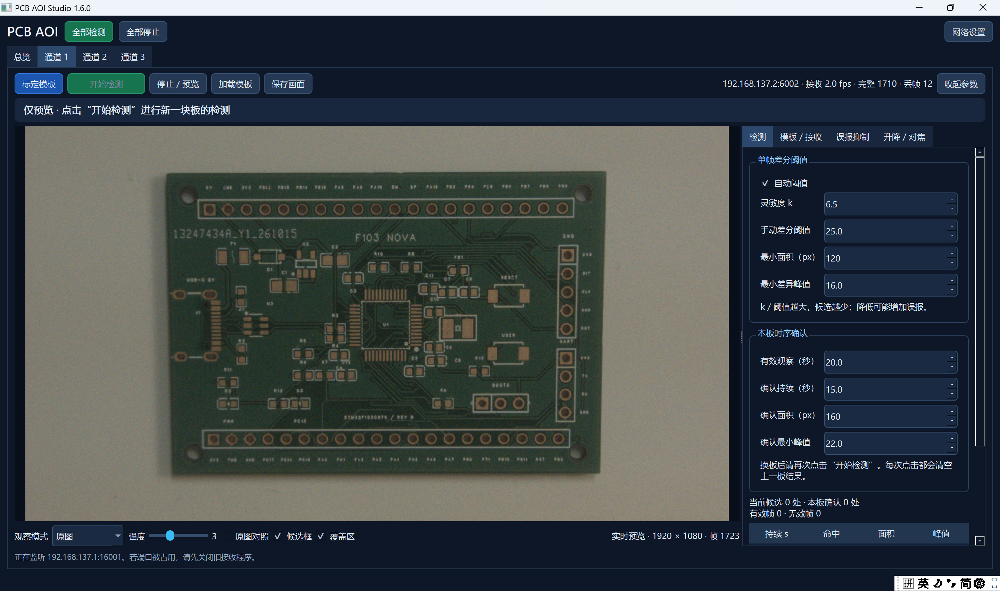

图1  PC 1.6实际收图截图。图中为1920×1080预览，接收状态显示2.0fps；该截图没有给出FPGA烧录文件身份，不能单凭它认定V26.7硬件验收已完成。

工程由“安防摄像头”演进为裸板外观检验平台。FPGA负责相机接入、原生1080p缓存、HDMI图像观察、TF照片存取、以太网图传和MG996R升降；PC负责模板标定、几何配准、颜色兼容检测、时序确认及记录。检测结论由PC产生。

报告覆盖用户可操作功能、数据路径、主要参数、实验结果及复现方法。图像优先选用本项目保存的实拍帧和真实界面；菜单渲染、本机回放和人工变换实验均单独注明。

> 当前工程不包含位移传感器读数、板厚或翘曲测量、LZ40步进驱动、FPGA独立AOI或YOLO推理。这些内容不列为已完成功能。

## 2 版本范围与功能边界

本报告以两份已交付源码和发布验证记录为基线。V26.7相对V26.6.1主要调整界面、对焦搜索和SD时钟；PC1.6相对PC1.5主要调整界面布局。报告中的历史实验用于解释现有检测方法，并不替代新版本的独立测试。 [S01][S02][S08]

| 模块 | 已实现功能 | 职责与边界 |
| --- | --- | --- |
| 相机与缓存 | IMX415四路MIPI、RAW10、Bayer重建、DDR完整帧 | 中心裁取1920×1080；空间像素不合并 |
| 本地显示 | HDMI、八种算法、菜单、曝光、降噪、照明 | 用于人工观察；显示处理不同于PC判定输入 |
| 存储 | TF卡FAT32、RGB24 BMP、照片回放 | 照片是选中算法的图像，菜单叠字不写入照片 |
| 升降 | 本地20µs调节、MG996R PWM、自动对焦 | 脉宽是命令，未测量实际高度 |
| 网络 | 三种开机编号、独立IP/MAC/端口、SCAM UDP | 每路默认2fps；同一bitstream最多对应3个预设身份 |
| PC检测 | 多帧模板、SIFT配准、传统差分、颜色兼容 | 需要与板型、板面、焦点及拍摄条件匹配的良品模板 |
| PC管理 | 三通道预览、排队检测、独立参数与台账 | 三路接收并行；高负载检测计算按队列执行 |
| PC控制 | 网络设置、远程PWM、PC自动对焦 | 需显式配置和使能；与FPGA本地对焦有控制权互锁 |

### 实验结论应如何阅读

“实拍”说明图像来自实体相机，不等于独立盲测；“本机回放”说明真实程序处理了录制数据，不等于真实无线吞吐测试；“RTL仿真”说明数字逻辑和测试模型一致，不等于实物光学或TF卡秒表结果。当前没有足够独立样本计算工业检出率、误报率或微米级精度。

## 3 系统结构与图像路径

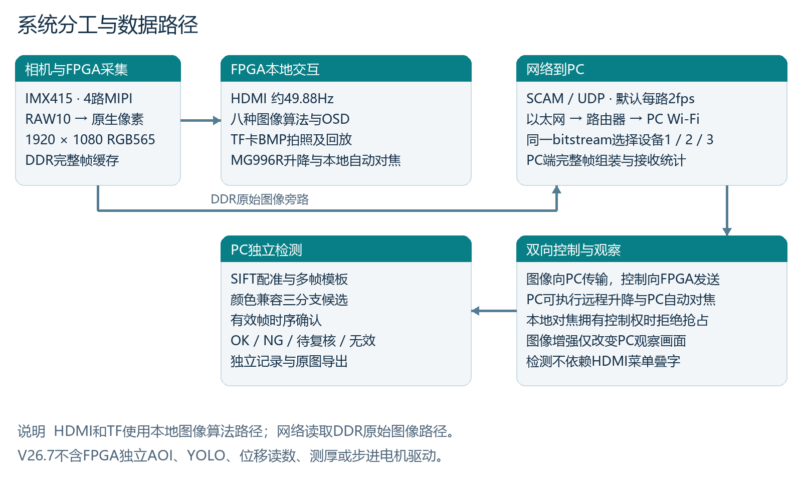

图2  系统分工与数据路径，按V26.7顶层、smart_app和PC1.6调用关系整理。

相机通过四条MIPI数据通道送入RAW10。接收链包含字节与通道对齐、包头与帧几何检查、异常帧拒绝及启动重试。原生Bayer重建保留各采样位置，再将RGB565写入DDR帧缓存。显示、网络及照片业务通过完整帧与缓存所有权协调，避免把前后两帧拼成一张图。 [S03]

HDMI支路依次经过空间降噪、选中的图像算法和OSD叠加。TF拍照读取算法处理后的图像、位于OSD之前；回放经RGB565解码进入缓存，并绕过重复算法处理。网络发送器读取DDR图像，采用RGB565传输，不携带HDMI菜单和候选框。

> PC“原始帧”指网络收到并还原的RGB图像，仍经过相机重建、颜色校正及RGB565量化，并非传感器RAW10文件。PC显示增强的结果与检测原始输入分别管理。

## 4 原生1080p与硬件接口

| 项目 | 当前实现 |
| --- | --- |
| FPGA综合目标 | PH1P50SBG484；顶层smart_camera_ddr_top |
| 图像有效尺寸 | 1920×1080；中心裁剪起点X=972、Y=556；DOWNSAMPLE=1 |
| Bayer重建 | 逐位置补齐缺失颜色；内部邻域插值不合并空间像素 |
| 帧存储与图传 | RGB565，单帧4,147,200字节；PC恢复为RGB/BGR三通道 |
| HDMI时序 | 总像素2080×1106；水平正、垂直负同步；约49.88Hz |
| 时钟 | 设计像素114.75MHz；实现报告114.758MHz；串行574.053MHz |
| 外设 | TF卡SPI、外部照明控制、蜂鸣器、数码管设备编号 |
| MG996R接口 | PWM接CEP9/F19；外部供电；CEP40/GND与舵机电源地相连 |

1920×1080提高了板面可用采样量，但清晰度还取决于镜头焦点、视场、曝光和照明。工程使用自定义约49.88Hz的1080p减消隐时序，不应在文档或演示中标成标准1080p60。接收帧率2fps也不是HDMI刷新率。 [S03]

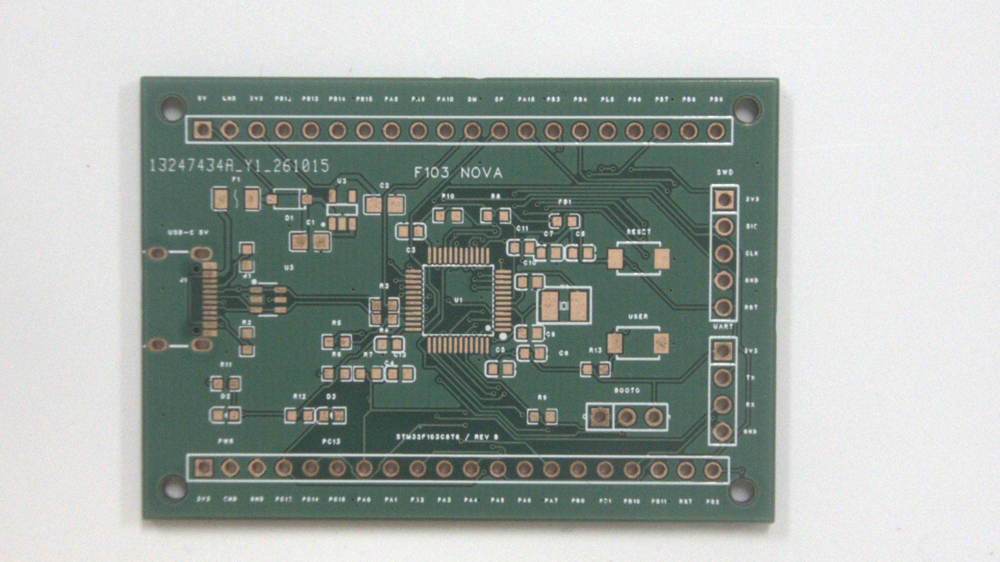

图3  保存的1920×1080正常板原始帧。板外背景占用部分视场；有效检验细节取决于PCB在原图中实际占有的像素。

机位调整应先保证焦点和稳定成像，再建立模板。只看板面中央可用于局部检验，但不能继续宣称全板覆盖；目前标定流程会寻找板外接四边形，过度裁切板边可能导致标定或配准失败。

## 5 FPGA菜单功能一览

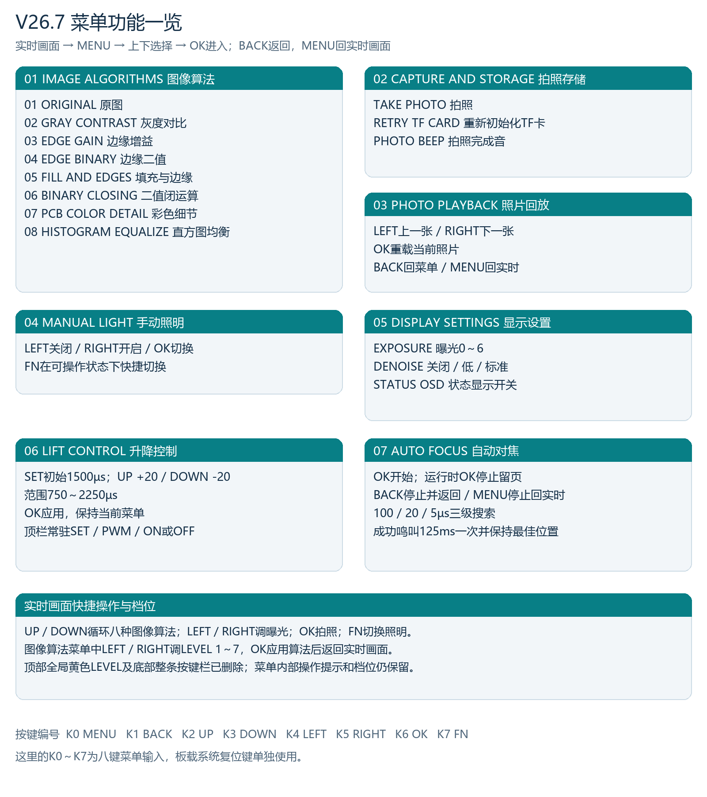

图4  V26.7菜单完整功能图。编号对应八键菜单输入，不把板载系统复位键当作菜单BACK键。

## 6 按键与OSD状态说明

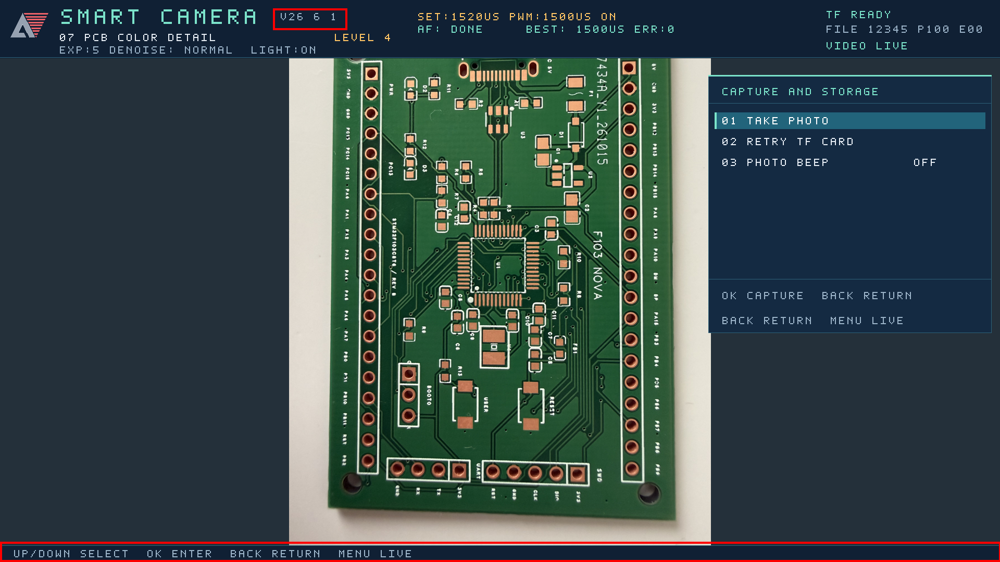

图5a  用户提供的历史界面参考，红框为待简化区域；采集方式未核实。

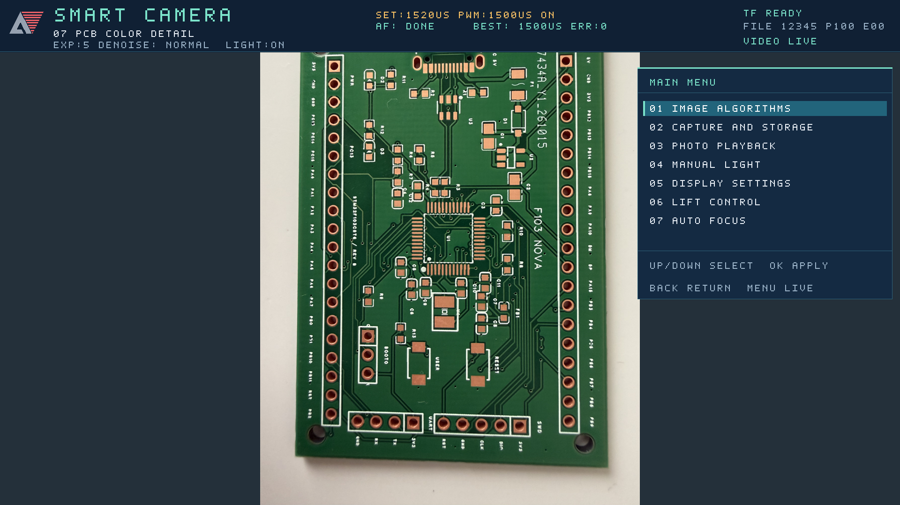

图5b  V26.7实际RTL渲染，示例状态由仿真设置。

| 场景 | 操作 |
| --- | --- |
| 实时画面 | K0/MENU开菜单；K2/UP和K3/DOWN循环算法；K4/LEFT和K5/RIGHT调曝光；K6/OK拍照；K7/FN切照明 |
| 普通菜单 | 上下选择；OK进入或执行；BACK返回上级；MENU回实时画面；按住方向键可重复调节 |
| 算法菜单 | 左右改变LEVEL 1～7；OK应用选中算法并返回实时画面 |
| 回放 | 左右前后切图；OK重载；BACK回主菜单；MENU回实时画面 |
| 升降菜单 | 上下仅修改SET；OK才下发目标并留在本页 |
| 自动对焦 | OK启动或停止；BACK/MENU取消并退出；成功保持最佳位置 |

顶栏保留安路Logo、算法名称、曝光EXP、降噪DENOISE、照明LIGHT、TF状态、文件编号FILE、操作进度P和错误E。SET表示待应用脉宽，PWM表示已下发的脉宽状态，ON/OFF表示输出使能。AF行显示阶段、BEST和ERR。 [S04]

V26.7删除版本文字、全局黄色LEVEL和底部整条按键栏背景。LEVEL仍在算法菜单中，用于强度或阈值；它不是拍照进度。关闭STATUS OSD后仍保留PWM与AF两行，便于观察升降状态。菜单内部的简短按键提示仍然存在。

## 7 图像算法一至四

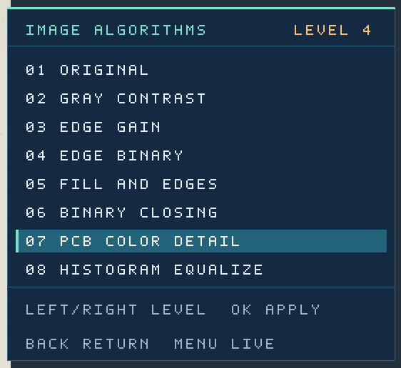

图6a  图像算法菜单，RTL裁图。

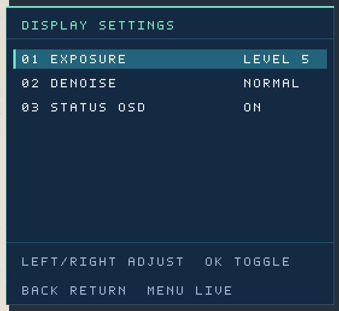

图6b  显示设置菜单，RTL裁图。

| 算法 | 实现与用途 | 调节效果 |
| --- | --- | --- |
| 01 ORIGINAL 原图 | 保留算法输入的彩色信息，适合建立人工参考和观察真实材质。前级颜色处理、空间降噪仍可能存在。 | LEVEL不改变该模式 |
| 02 GRAY CONTRAST 灰度对比 | 以(R+2G+B)/4构成亮度，围绕128扩展灰度，输出三通道灰度。用于比较浅划痕与绿油亮度差。 | LEVEL1～7对应增益约1、1.25、1.5、2、2.5、3、4；饱和截断 |
| 03 EDGE GAIN 边缘增益 | 用中心与上下左右邻域差构成边缘响应，并放大到可见灰度。适合焊盘、丝印、走线轮廓观察。 | 档位升高，弱边缘更亮，同时可能放大噪声 |
| 04 EDGE BINARY 边缘二值 | 对边缘响应阈值化，形成黑白轮廓。适合人工比较线条连续性及结构位置。 | LEVEL改变阈值；高档可减少弱边缘 |

这四种算法输出的是观察图，不直接产生PCB合格判定。边缘图里的断点可能来自阈值或照明；没有白色响应也不代表没有划痕。算法以帧开始锁定模式和阈值，并对不同路径进行流水线延迟对齐，避免一帧内部混用两组参数。 [S05]

## 8 图像算法五至八

| 算法 | 处理与适用观察 | 注意事项 |
| --- | --- | --- |
| 05 FILL AND EDGES 填充与边缘 | 将亮度区间映射为深背景/绿色填充，再以白色突出边缘，便于同时看区域分布和边界。 | 颜色为伪彩表达，不能用于判断真实铜色 |
| 06 BINARY CLOSING 二值闭运算 | 亮度阈值形成黑白图，之后先膨胀再腐蚀，连接细小断隙、填补局部小孔。 | 会改变细节形状；不能把闭合后的连通性当作电气连通 |
| 07 PCB COLOR DETAIL PCB彩色细节 | 从邻域提取带符号高频细节，经8灰阶软抑噪后分别加入RGB，使用饱和运算，保留彩色观察。 | 高档可能突出纹理和反光；平坦噪声有抑制但未完全消除 |
| 08 HISTOGRAM EQUALIZE 直方图均衡 | 根据图像灰度分布构建映射，提升亮暗范围利用率，输出灰度。 | 需要有效统计；极端反光或大背景会影响视觉效果；不使用LEVEL |

### 本地观察和PC检测如何配合

FPGA八种算法便于HDMI上人工排查。PC也有独立的观察增强。当前网络从DDR读取原始图像，所以改变HDMI选中算法不会把该伪彩图直接送入PC检测；改变镜头焦点、曝光、白平衡或照明则会影响网络输入，需要重新确认模板。 [S03][S05]

TF保存的是所选算法图像。若保存EDGE BINARY或FILL AND EDGES，回放看到的就是对应黑白或伪彩图；回放旁路算法用于防止同一张照片被重复处理。建议为留档选择ORIGINAL或PCB COLOR DETAIL，并记录所用参数。

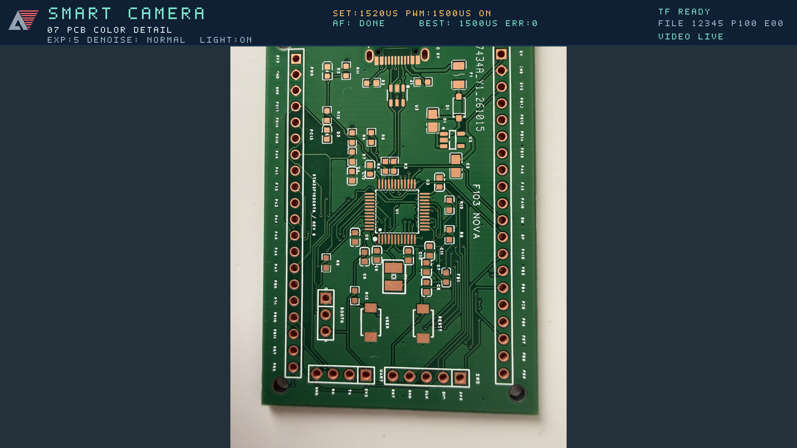

图7  V26.7实时画面RTL渲染示例。此图用于界面说明，不是新增硬件效果实验。

## 9 曝光降噪照明与颜色校正

| 功能 | 操作与实现 | 对检测的影响 |
| --- | --- | --- |
| 曝光EXP | 显示设置或实时画面左右调0～6；通过相机寄存器更新；忙与错误状态有提示。复位默认6。 | 过曝会抹掉浅划痕和金属细节；改变后应等待画面稳定并重新标定 |
| 空间降噪 | OFF/LOW/NORMAL三档；中心3×3范围门控二项滤波，邻域差大时保留中心；回放旁路。 | 改善本地噪声但可能削弱细纹；该后级不等同于网络输入预处理 |
| 手动照明 | 专用菜单左右开关、OK切换；FN为快捷切换。 | 光照方向决定划痕与反光；先固定再标定，不能靠增亮代替正确打光 |
| Bayer选择 | 独立板载颜色按键KEY3循环CFA配置；默认已采用工程匹配设置。 | 调试功能，正常使用不应反复切换，否则颜色与结构异常 |
| 白卡校准 | 独立板载颜色按键KEY4请求一次白卡校准，使用RAW域通道增益估计。 | 只能在正确白色参考和稳定光照下操作；不可把PCB当白卡校准 |

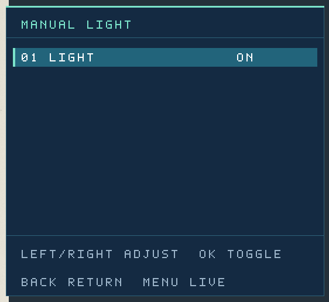

图8a  照明菜单，RTL裁图。

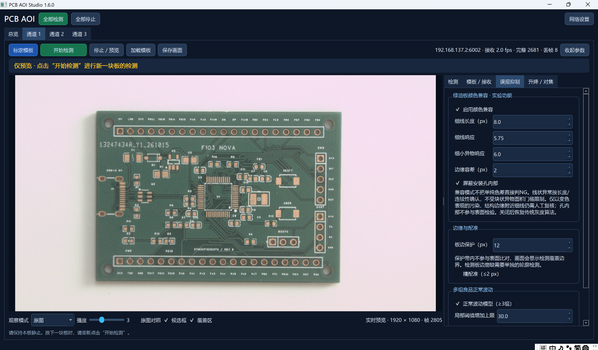

图8b  实际PC收图，使用颜色兼容页观察当前画面。

板载颜色按键与八键菜单输入是不同接口。颜色校准、曝光及光照发生在成像链上，可能改变检测数据；PC底部观察增强仅修改显示。报告中的实际截图存在曝光和摆放差别，不能把它们直接当作只改变一个参数的对照实验。

## 10 TF卡拍照与文件完整性

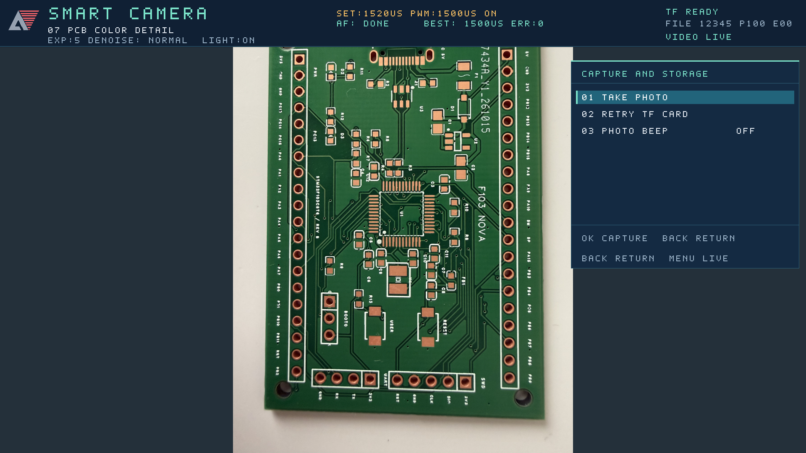

图9  V26.7拍照与存储菜单，RTL渲染；FILE12345等为测试值。

拍照可以在实时画面按OK，或进入CAPTURE AND STORAGE选择TAKE PHOTO。只有卡和图像准备就绪才接受请求。拍照锁定完整画面，等待缓存稳定，再由96KiB像素环向FAT32与SD扇区写入链提供RGB24字节流。 [S06]

| 项目 | 当前行为 |
| --- | --- |
| 文件格式 | 1920×1080、24位BMP；54字节头加6,220,800字节像素，合计6,220,854字节 |
| 文件名和编号 | IMG加五位十六进制编号的BMP，例如IMG0003D.BMP；顶栏FILE对应当前编号；由FAT32流程管理 |
| 进度 | 按实际扇区工作量计算；P099不提前；P100仅在成功完成后出现 |
| 完成条件 | 保留CRC16、写响应、卡忙等待及CMD13状态检查；目录项最后提交 |
| 完成音 | PHOTO BEEP可开关；与自动对焦成功音是不同事件 |
| 错误恢复 | 卡错误或插卡后进入RETRY TF CARD重试初始化；错误状态不伪装成功 |

OSD位于照片采样点之后，因此照片中不写入菜单、Logo和状态条。照片可以包含当前图像算法效果。大文件保存时间由SPI传输、逐字节调度、卡内部写忙、FAT查找以及目录提交共同决定；P计数不是固定十秒倒计时。

> FAT32双镜像和“目录最后提交”提高了操作一致性，但不能由此推导任意断电都能恢复；本报告没有提供真实断电破坏试验。

## 11 TF回放与传输提速

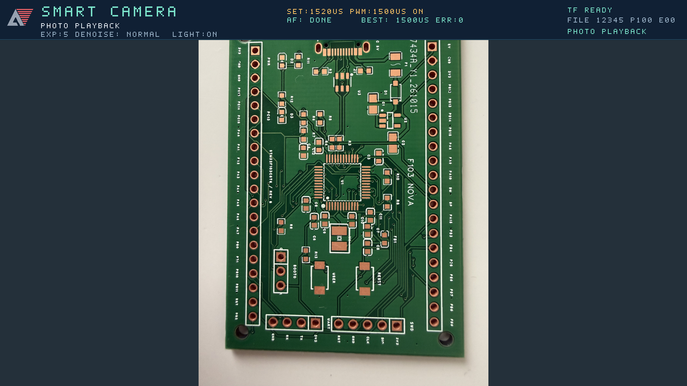

图10  V26.7回放页面RTL渲染。回放通过完整照片有效性检查后才切换显示。

PHOTO PLAYBACK加载卡内照片。LEFT上一张、RIGHT下一张、OK重载；没有邻图时显示NO NEIGHBOUR，格式不兼容显示BAD PHOTO。BACK/MENU能取消读取返回；照片写入期间不允许中途取消，以维持提交一致性。历史分辨率或布局不同的照片不保证兼容当前原生1080p回放。

| 项目 | V26.6.1 | V26.7 |
| --- | --- | --- |
| 高速SPI整周期 | 6个主时钟周期，约19.125MHz | 5个主时钟周期，约22.95MHz |
| 高速相位 | 低3拍、高3拍 | 低3拍、高2拍 |
| 初始化 | 232拍等长半周期，约247.3kHz | 保持相同 |
| 纯BMP负载理论下限 | 约2.6022秒 | 约2.1685秒 |
| 4扇区模型写入，0µs卡忙 | 113048周期 | 95960周期，减少15.1% |
| 4扇区模型读取 | 106704周期 | 89968周期，减少15.7% |
| 4扇区模型写入，100µs卡忙 | 158744周期 | 141712周期，减少10.7% |

表中周期来自真实SD控制器连接独立引脚级SDHC模型，MISO延迟14ns，读数据逐字节验证。线速增加20%不等于整次保存快20%，理论下限也不是实拍耗时。V26.7真实TF卡兼容性和秒表结果仍需上板验收。 [S01][S06]

## 12 本地手动升降与控制权

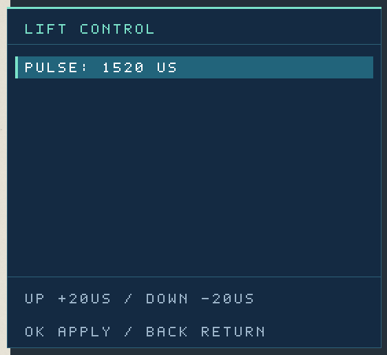

图11a  升降菜单，RTL裁图。

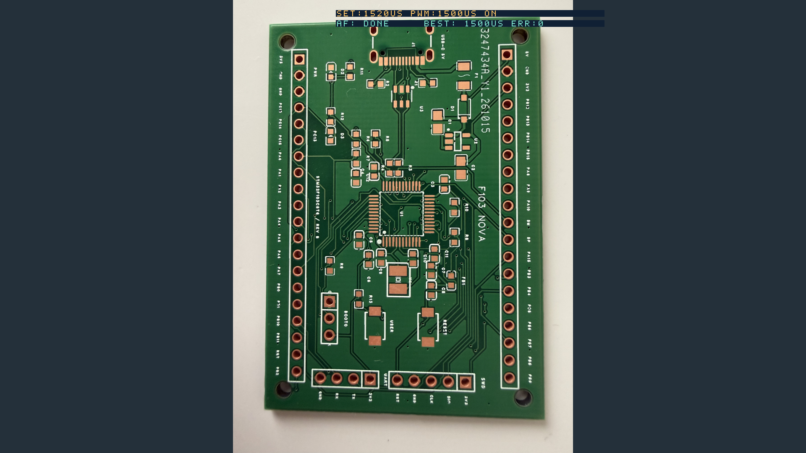

图11b  关闭常规OSD后仍保留PWM和AF状态，RTL渲染。

升降使用普通角度定位型MG996R，通过外部电源供电并与FPGA共地。FPGA仅输出控制信号，不用开发板3.3V引脚给舵机供电。当前机构已按用户确认采用750～2250µs范围；脉宽与高度的映射取决于机构，软件未计算毫米高度。 [S07]

| 项目 | 实际行为 |
| --- | --- |
| 初始状态 | SET和PWM状态初始1500µs；复位不自动使能PWM |
| 调节 | UP +20µs、DOWN -20µs，到750/2250边界饱和，不越界 |
| 应用 | 按OK下发目标并留在升降页；SET与PWM分开表示待应用和已执行指令 |
| 斜坡 | 本地接管后，每20ms最多改变5µs，避免瞬时跳到远端脉宽 |
| 退出菜单 | 仅返回界面，不自动回零；已使能时保持输出 |
| 远程互锁 | 本地自动对焦运行时持有控制权，拒绝远程运动抢占；只读查询仍允许 |

舵机接到命令不等于平台已达到精确高度。齿隙、连杆非线性、负载和振动都可能改变实际位置。顶栏PWM是控制器命令反馈，不能当作编码器位置，也不能把5µs步进换算为测厚精度。

## 13 FPGA本地自动对焦原理

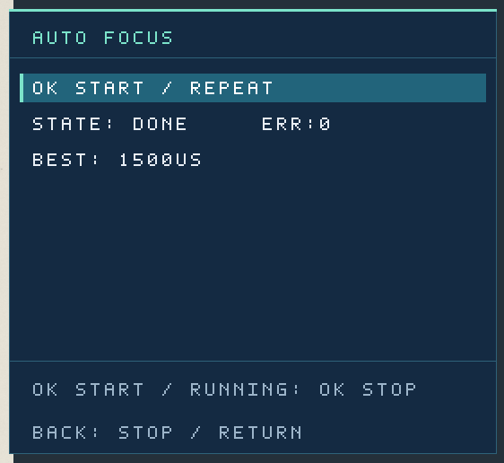

图12a  自动对焦菜单，RTL裁图。

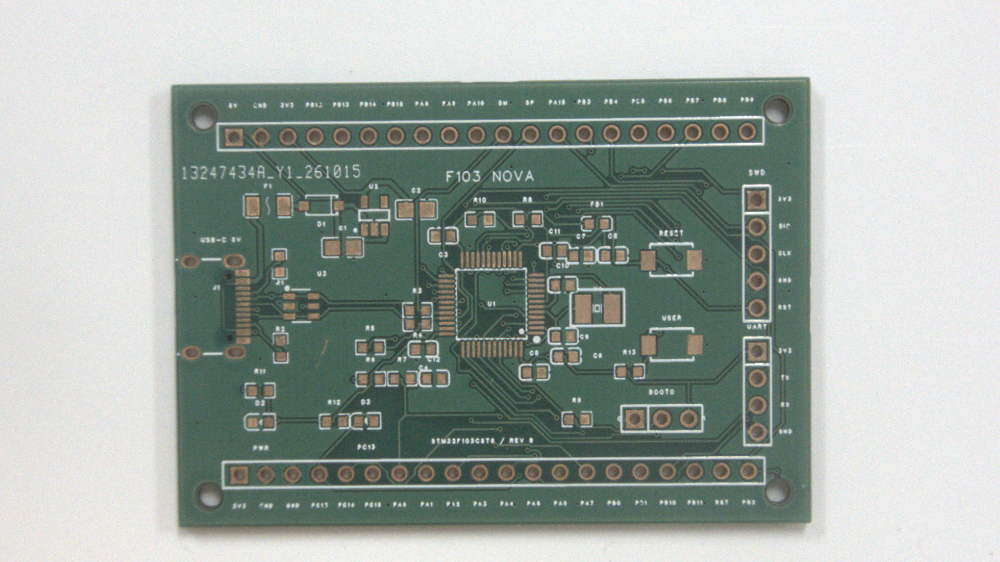

图12b  实拍纹理示例，中心应有文字、焊盘或走线。

本地自动对焦不依赖PC计算。focus_metric在算法增强之前，统计画面中心512×256区域的绿色通道Sobel能量。小于8灰阶的梯度设死区、过大梯度截断，并以区域亮度平方归一化；帧号用于拒绝重复或旧图像。严重过曝、过暗或采样不完整不作为有效指标。 [S07]

| 阶段 | 范围与采样 | 目的 |
| --- | --- | --- |
| 粗扫 | 750～2250µs，100µs步长；每点2个不同新帧 | 定位主要清晰度峰 |
| 中扫 | 粗峰附近约±100µs，20µs步长；每点2帧 | 缩小细扫区间 |
| 细扫 | 中峰附近约±20µs，5µs步长；每点4帧 | 确定最终脉宽网格 |
| 回位复核 | 先到最佳值低侧，再同向靠近；等待500ms，4帧复核 | 降低回差影响，并验证峰值能否复现 |

每次到达目标后常规等待250ms；执行机构仍遵守5µs/20ms斜坡。若整条曲线过平、最佳点在750或2250边界、回位分数不足峰值75%或低于最低值，不报告成功。只有复核通过才进入DONE、ERR0，并鸣叫一次125ms。

> 对焦改变的是摄像头与板面的距离，镜头调焦环保持固定。它寻找图像清晰度最大点；没有测距传感器，也不输出厚度或相机绝对高度。

## 14 本地对焦性能与异常处理

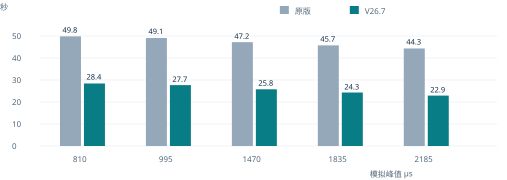

图13  新旧真实对焦RTL的配对仿真时间。固定50fps新帧、相同执行机构斜坡和确定性噪声；不是实物计时。

| 模拟峰值 µs | 原版 秒 | V26.7 秒 | 时间减少 |
| --- | --- | --- | --- |
| 810 | 49.833 | 28.413 | 43.0% |
| 995 | 49.093 | 27.673 | 43.6% |
| 1470 | 47.193 | 25.773 | 45.4% |
| 1835 | 45.733 | 24.313 | 46.8% |
| 2185 | 44.333 | 22.913 | 48.3% |

五个模型场景最终落到相同峰值网格，移动请求从59次降至38次。加速来自三级搜索和常规等待缩短，未增大PWM跳变速度。真实机构若250ms后仍振动，必须先调整稳定等待或机构，不能只以完成鸣叫作为清晰度验收。 [S01][S07]

| AF错误 | 含义与处理 |
| --- | --- |
| 1 | 用户取消；保持当前命令，不自动回零 |
| 2 / 3 | 图像不足或旧帧 / 舵机握手或到位命令超时 |
| 4 / 5 | 图像不可用或曲线过平 / 回到最佳点后清晰度无法复现 |
| 8 / 9 | 总流程超时 / 峰值落在搜索边界 |

运行时OK停止并留页，BACK停止并回菜单，MENU停止并回实时。单阶段超时12秒、图像取样等待2.5秒、总超时120秒；启动前的空闲时长不会计入新一轮阶段超时。

## 15 启动保护与诊断显示

相机配置、MIPI校准和DDR就绪共同决定是否发布有效图像。工程保留启动诊断，而不是在无图时只显示黑屏。收到干净实时帧后诊断覆盖消失；DMA锁存故障时可再次显示。诊断模块是被动显示，不修改验收或清除错误。 [S03]

| 字段 | 用于定位的问题 |
| --- | --- |
| CFG / ERR / IDX / TRY | 相机寄存器配置状态、失败索引及启动重试次数 |
| BYTE_HZ | 接收字节时钟活动情况；与显示刷新率不同 |
| MIPI DONE / EYE / TAP | 各通道校准与可用采样窗口 |
| FS / FE / CSI | 帧起止及CSI错误计数 |
| GEO / ROWS / PAIRS | 有效行数与输出像素数量是否符合预期 |
| DDR FLAGS / STORE / DROP | DDR初始化、帧提交及丢弃状态 |
| DMA CAUSE / WR / RD | 首个DMA异常原因、读写活动 |
| BADHDR / CRC / TRUNC | 包头、数据完整性及截断问题 |
| MISSING_SOT | 接收突发中缺少起始标记的计数 |

诊断值主要为十六进制。必须结合板上实际现象和帧计数是否递增判断，不能只凭某颗LED亮灭认定摄像头正常。当前顶层把原O_led低三位复用为HC595数码管串行信号，因此旧版LED心跳说明不能直接沿用。

数码管在身份选择未完成时显示横线，完成后显示1、2或3，非法身份显示E。启动诊断内部仍可能出现V2632等历史字符串，它不是发布文件身份的可靠依据；以烧录bitstream哈希和工程清单为准。

> 等待摄像头或诊断棋盘表示链路没有获得可发布图像，不是PC模板缺陷。先解决采集、帧几何或DDR故障，再进行标定和AOI。

## 16 同一bitstream的三台设备身份

FPGA开机在网络释放前采样左右键，身份锁定后不再随运行按键改变。无需为三块板分别编译固件。将各板以太网接路由器LAN端，PC连接同一路由器的5GHz主Wi-Fi，使用彼此不同的设备编号。 [S09]

| 设备 | 开机选择 | FPGA IP | MAC | PC接收端口 |
| --- | --- | --- | --- | --- |
| 1 | 不按选择键 | 192.168.137.2 | 02:23:45:67:89:AB | 16001 |
| 2 | 按住LEFT/K4再复位 | 192.168.137.3 | 02:23:45:67:89:AC | 16002 |
| 3 | 按住RIGHT/K5再复位 | 192.168.137.4 | 02:23:45:67:89:AD | 16003 |

保持选择键直到数码管编号稳定后再松开。两个选择键同时按下或启动选择不稳定时，身份为0，网络保持禁止，需重新复位选择。板载数码管显示已选编号；本版不做断电保存，每次上电按相同方式选择。

### 地址设置的范围

这不是任意编辑IP的菜单。三种身份采用预设IP、MAC和端口公式；要扩展更多板或变更地址段，需要同时修改FPGA身份映射和PC通道配置。PC接收地址固定为192.168.137.1，FPGA控制端口为6002。MAC使用本地管理地址，避免三板烧同一文件后地址冲突。

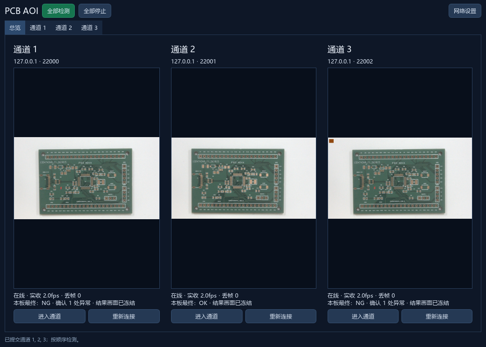

图14  PC1.6实际打包EXE三通道回放。此图证明三路软件工作区可同时运行，不能作为三块实体板已同时联网的证明。

路由器采用TL-WDR8690的既有方案。网络不需要互联网即可传图；若PC同时需要聊天或其他联网服务，应保留现有网关与DNS。不要把演示网段的静态地址误设为互联网网关。

## 17 图传协议带宽与接收机制

| 项目 | 数值与含义 |
| --- | --- |
| 像素载荷 | 1920×1080×2 = 4,147,200字节每帧，RGB565 |
| 分包 | 每包图像块最多1408字节，SCAM头32字节，每帧2946包 |
| SCAM头 | 版本、像素类型、帧号、宽高、包序号/总包数、偏移、总字节数、载荷长度等 |
| 单路2fps | 纯像素约66.36Mbit/s；含SCAM头约67.86Mbit/s |
| 三路2fps | 含SCAM头约203.59Mbit/s；还未计UDP/IP、以太网和Wi-Fi开销 |
| 目标帧率 | FPGA默认2fps；底层兼容1～4fps命令；PC1.6日常界面没有另设全局帧率滑块 |

每个网络事务锁定一个完整DDR帧，分行读取并发送。接收端核对来源、格式、尺寸、偏移和包序号，支持乱序组装；只发布完整帧，超时或损坏帧丢弃，不把缺包内容补成可检测画面。图像用UDP传输，没有为每张图提供TCP式可靠重传。 [S09][S10]

### 三路并行和计算调度

PC每通道由独立接收进程处理图像，通过共享内存把完整帧交给界面，避免单一Python线程在三路大量UDP包下成为瓶颈。检测进程集中执行计算任务；全部检测会依次服务已准备好的通道，其余接收继续。队列轮到某通道时取当时最新图像，不使用最初排队时的旧图。

“接收2fps”不等于算法每路都处理2fps。丢帧、CPU负载和三路调度会增加完成时间；有效帧不足不会仅因墙上时间已到就给OK。Wi-Fi额定链路速率也不能直接当作净荷吞吐，三板真实同时传输仍需现场验证。

> 照片保存或回放使用缓存冻结状态，网络可能展示静态画面或暂时等待；进行PC生产检验前应让FPGA返回实时图像并确认帧号持续更新。

## 18 PC程序功能一览

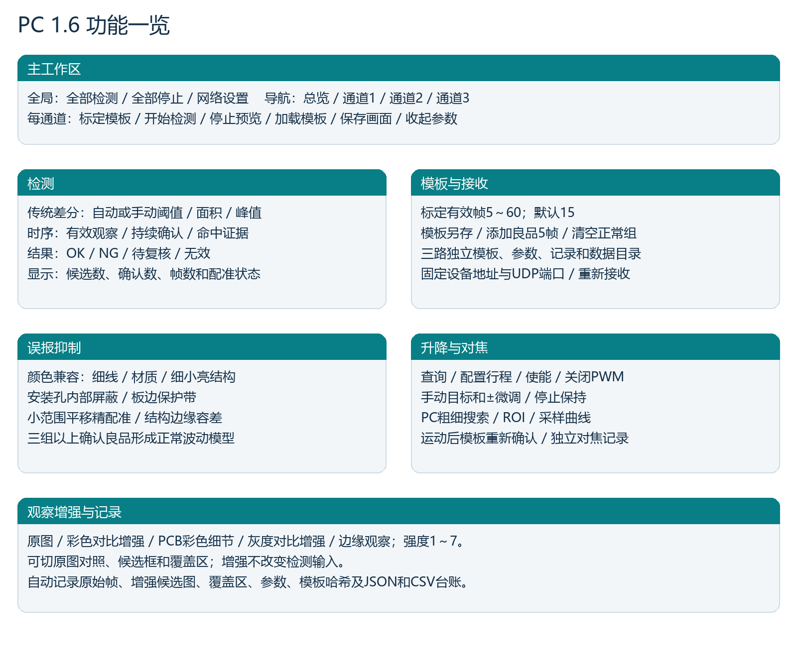

图15  PC1.6功能分区。三个通道均为完整功能，模板、检测参数、记录和升降配置分别保存。

PC1.6只压缩界面，不削减算法。全局工具栏保留全部检测、全部停止和网络设置；通道页保留五个常用操作。顶部接线说明、重复标题和算法长说明移走，接收状态和判定结果仍保留，完整消息可悬停查看。 [S08]

## 19 PC日常操作与结果界面

图16  PC1.6实际收图与误报抑制页面。图中细线长度8、响应5.75等是拍摄时设置，报告默认参数另列。

| 操作 | 用途 |
| --- | --- |
| 标定模板 | 以确认良品采集多帧形成当前板面的基准；标定期间保持机位和照明 |
| 开始检测 | 为一块新板建立新会话，清空上板证据，开始累计有效观察 |
| 停止 / 预览 | 终止当前检测或排队，回到实时预览，不自动判为合格 |
| 加载模板 | 选择已有NPZ模板；必须确认板型、正反面、机位和焦点一致 |
| 保存画面 | 导出当前原始帧、完整增强图和参数快照 |
| 收起参数 | 隐藏右侧参数栏扩大预览，再点击显示参数恢复 |
| 结果冻结 | 结束后保持本板图像、框和结论；换板需再次点开始检测 |

全局全部停止会同时停止各路检测并取消升降任务；“停止本通道升降”用于只停止指定通道的运动。总览显示三路缩略图与状态，通道页进行详细设置。等待图像、仅预览和模板就绪都不是OK结论。

实时预览隐藏空进度条；标定或检测时显示实际进度。参数改变会中止旧参数的当前检测并重新建立会话，避免同一块板混用两套阈值证据。

## 20 模板标定与良品建模

本系统采用参考模板法，不需要Gerber或重新训练YOLO。新板型、正反面、镜头焦点或明显机位变化，应使用对应的确认良品重新标定；不能任意拿一张别的PCB直接得出可靠结论。模板在PC端保存，FPGA不保存AOI检测模板。 [S11]

| 步骤 | 实现细节 |
| --- | --- |
| 第一帧 | 由灰度分割、形态学闭运算和最大外轮廓求板面外接四边形 |
| 统一画布 | 横向宽1180像素，高按板面比例计算并限制200～1400；不是把整幅1080p直接逐像素相减 |
| 多帧对齐 | 后续良品帧经SIFT和单应性配准，统一到模板坐标；不合格帧不累计 |
| 模板融合 | 默认15个有效帧逐像素中位数，界面允许5～60帧；保存原始彩色模板及传统预处理模板 |
| 保存 | NPZ文件包含模板、几何变换、掩膜、采样信息和良品组；支持加载及另存 |
| 良品扩展 | 每次“添加另一块良品”采5帧形成一组；初始标定也计一组，至少3组才采用正常波动信息；最多12组 |

多帧中位数用于降低闪烁和瞬时噪声，不能把同一块板的15帧解释为15块独立样本。良品组应来自已确认正常、具有代表性的不同板或状态；算法不会自动吸收待测缺陷板作为正常样本。

图17  良品标定应使用与待测板同面、同机位和同照明的清晰画面。此图为保存原始帧，不包含模板框。

> 1080p输入保留更多细节，但检测仍变换到1180宽的规范画布。面积和长度参数多数以该画布像素计，不能直接换算为原图像素或毫米。

## 21 几何配准与传统灰度差分

几何配准先解决板子平移、旋转和一定透视变化，再比较表面信息。参考及当前灰度图使用局部对比度处理，SIFT最多提取4000特征；最近邻距离比0.75过滤匹配，RANSAC以4像素阈值估计单应性。至少25内点、配准中位误差不超过4像素才进入检测。 [S11]

| 环节 | 传统路径行为 |
| --- | --- |
| 覆盖检查 | 将原图有效区域投影到画布；板边保护后，至少覆盖基准有效区90% |
| 可选精配准 | ECC只拟合不超过2像素的残余平移，相关性变好才采用；不做可变形配准 |
| 亮度处理 | 模板绑定的CLAHE、分区亮度归一化、灰度高斯处理 |
| 局部容差 | 与模板±1画布像素的九种位移取最小绝对差，降低边缘细小错位影响 |
| 自动阈值 | T = max(10, median(D) + k × 1.4826 × MAD(D))；手动时直接用固定阈值 |
| 区域生成 | 阈值分割、3×3开运算、9×9闭运算、连通域面积和差分峰值筛选 |
| 坐标还原 | 候选由模板坐标逆变换到原始帧，画框不丢失几何对应关系 |

k越大通常候选越少；面积或峰值门槛越高也越保守。传统算法对铜箔黄灰差异和绿油深浅变化敏感，因为它们同样产生灰度差。只提高阈值会同时压掉弱划痕，这正是颜色兼容模式引入的原因。

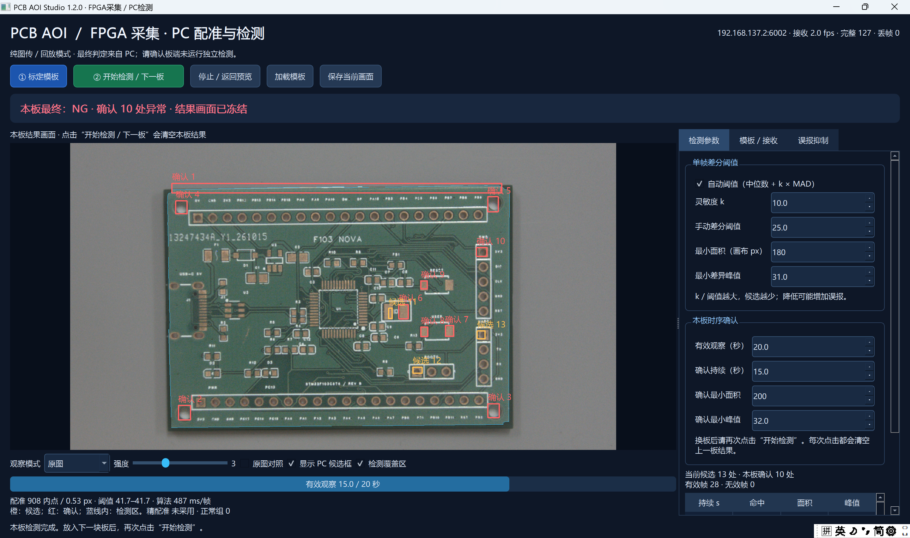

图18  历史PC1.2实拍检测截图，多处金属焊盘和板边产生候选。它用于说明旧问题，不代表PC1.6的最终检测结果。

## 22 颜色兼容模式的三条证据链

PC1.6默认启用针对绿油裸板的颜色兼容实验模式。该模式保留几何配准，改用彩色材质范围与新出现的局部结构。单纯“黄色铜箔变灰”或“浅绿变深绿”不直接作为NG证据。关闭开关后回到传统灰度差分。 [S12]

| 分支 | 识别对象与算法 | 确认依据 |
| --- | --- | --- |
| scratch 细线 | 多尺度亮脊响应减去参考允许结构；沿多个方向连接断续细线，以长度、细长比、宽度和原始种子占比筛选。 | 长度和细线响应；不套用块状异物最小面积 |
| material 材质变化 | 比较绿油与非绿油的归属，稳定区域出现新的材料归属并形成足够连通面积。 | 候选最小面积、确认面积及持续时间 |
| structure 细小亮结构 | 局部亮细节相对参考明显增大，且绝对亮度超过参考允许范围，用于同色铜片等小结构。 | 面积至少20画布像素和结构响应，再持续确认 |

参考绿油HSV色相范围为35～100，并设置最低饱和度和亮度；参考有效板区中绿油比例小于10%时返回模式不适用，不应继续当作正常板。黑色、蓝色、红色阻焊板没有在本报告中证明兼容。

细线检测使用σ=0.8、1.2、1.8的多尺度二阶结构响应。模板的已有结构邻域构成允许范围，避免焊盘轮廓仅因亮度变化整圈报警。材质变化使用3×3开闭运算整理区域。多良品模式扩展正常材质和强结构范围，不把待测帧写回模型。

| 兼容参数 | 界面初始值 | 调节方向 |
| --- | --- | --- |
| 细线长度 | 18画布像素 | 降低可接纳短线，也会增加碎纹理候选 |
| 细线响应 | 2.5 | 降低更敏感；峰值不是缺陷概率 |
| 细小异物响应 | 12 | 降低可接纳弱小结构，同时更易受反光影响 |
| 结构边缘容差 | 2画布像素 | 增大减少边缘误报，也扩大邻边漏检风险 |
| 安装孔内部屏蔽 | 开启 | 排除角部孔内；不检验孔内部质量 |

> 该模式主动放过部分颜色差异，因此只表现为变色的污染、同色且没有可见结构的异物、结构边缘附近细划痕可能漏检。它不是按缺陷语义训练的多类别AI模型。

## 23 细划痕定位与专用确认

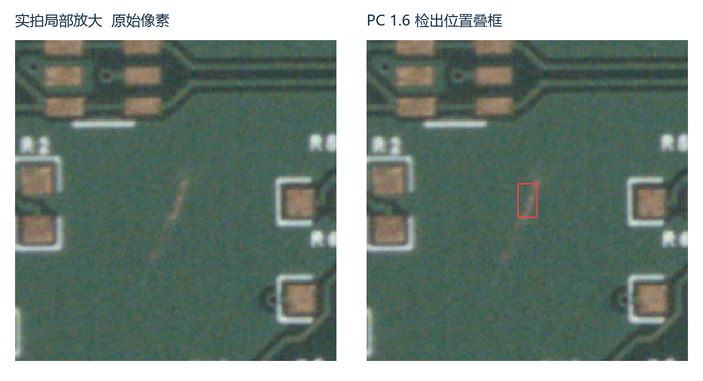

图19  同一保存实拍帧由PC1.6原函数重新计算。左为原始局部像素放大，右为检出位置叠框；只增加显示框，没有人工补画划痕。

本次报告图示计算使用交付PC1.6的TemplateMatcher及surface_features原函数，输入“回放划痕.png”和“回放验证模板.npz”。参数为细线长度18、细线响应2.5、结构响应12、板边保护12。原始输入哈希前后相同；输出记录随报告保存。

| 输出项 | 本帧结果 |
| --- | --- |
| 类型 | scratch |
| 原图框 | 约(616.24,655.59)～(628.01,678.40) |
| 画布连通域面积 | 72像素 |
| 细线响应峰值 | 7.05 |
| 画布长度 | 24.21像素 |

这条细线面积只有72，低于某些传统块状确认门槛，但长度超过18、响应超过2.5，可进入细线时序确认。将所有缺陷统一要求“大面积+高灰度峰值”，会把可见的长细划痕滤掉。

本页是已知开发样本的算法复现，不是新增独立缺陷。响应7.05不是缺陷概率，长度24.21也不是毫米。是否最终NG还要满足多帧持续、命中比例和新鲜度条件。 [S12][S13]

## 24 一块板的时序证据与四种结论

| 结论 | 含义 |
| --- | --- |
| NG | 同一类、同一区域的强证据持续达到确认要求，形成确认异常 |
| OK | 有效观察时间和有效帧数均满足要求，且没有确认异常或持续待复核证据 |
| 待复核 | 出现持续候选但没达到强确认条件；保留证据，要求人工看图 |
| 无效 | 连续配准失败、覆盖不足、流不足或超时；不等同于没有缺陷 |

BoardSession为每块板维护独立会话，只累计不同且时间递增的有效帧。默认有效观察20秒、确认持续15秒；最低有效帧数为max(4, ceil(观察时间×0.8))，即默认至少16帧。确认还要求平均命中率至少0.8次/秒、命中比例至少60%。 [S13]

候选在模板坐标内按类型与位置关联，再把原图坐标用于显示。间隔超过2秒会清除活动轨迹并重新累计连续观察；连续3次对齐或覆盖失败使会话无效。相同帧重复处理不增加证据，单纯等待不会替代有效图像。

持续至少min(3秒,确认时间)、至少3次命中且命中比例达到60%的候选，会进入待复核证据。若随后在观察窗内仍不够强，则结束为待复核，而不是因为没达到NG就自动给OK。

| 参数 | 界面默认 | 作用 |
| --- | --- | --- |
| 有效观察 / 确认持续 | 20秒 / 15秒 | 观察必须长于确认；三路队列时实际等待可能更长 |
| 候选面积 / 确认面积 | 120 / 160画布像素 | 颜色兼容中主要用于材质分支；细线另走长度规则 |
| 传统差分k / 峰值 | 6.5 / 16 | 颜色兼容开启时这些传统控件禁用 |
| 传统确认峰值 | 22 | 仅传统强证据判断；细线与结构使用各自响应 |

> 结束结果为终态并冻结画面。换入下一块板后必须再次点击“开始检测”；不能把上一块板的OK继续用于新板。

## 25 板边孔洞与正常波动抑制

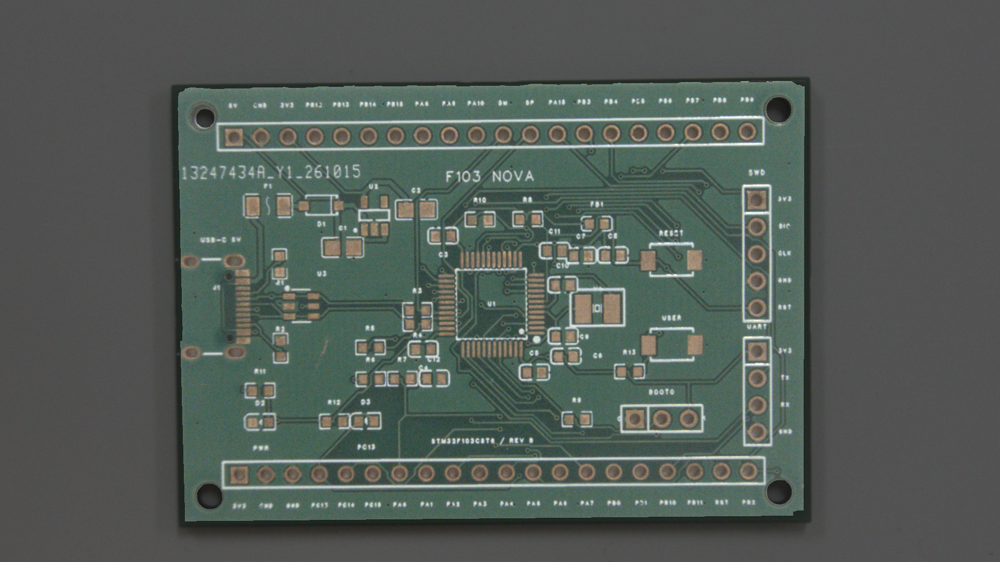

图20  PC1.6对实拍帧计算的覆盖区示意。图外与排除区压暗，仅便于查看；正式覆盖区原始掩膜随图包保留。

默认板边保护带为12画布像素，可调8～80。图像越过视场、配准残差和板外阴影容易在边缘形成高差分；保护带明确排除这些区域，不靠把整张图阈值抬高来压制。它同时意味着板边崩缺不在该表面检测覆盖内，应另做轮廓检验。 [S11][S12]

颜色兼容模式可自动定位角部安装孔并屏蔽内部。孔内背景、台面和反光容易随位置变化，屏蔽能降低正常孔误报；但不能再宣称检验了孔内部、孔壁或通孔电气状态。画面“覆盖区”用于让操作者看到实际有效范围。

| 功能 | 默认 / 范围 | 实际用途 |
| --- | --- | --- |
| 结构边缘容差 | 2 / 0～8画布像素 | 已有结构附近留容差；越大越可能漏掉邻近细线 |
| 精配准 | 默认关闭；残余平移≤2像素 | 仅采用改善相关性的微小平移，防止大变形抹掉缺陷 |
| 正常波动模型 | 默认允许，至少3组才生效 | 传统路径按像素MAD形成局部阈值；增加量上限30 |
| 颜色兼容良品组 | 至少3组扩展正常结构/材质 | 不抬高细线噪声门槛；扩展允许的材料与强边缘范围 |

良品应由人工确认后添加，不能把每次误报都直接“学习成正常”。被污染或有真实划痕的板混入良品组，会扩大容忍范围并掩盖后续异常。

## 26 PC观察增强与原图对照

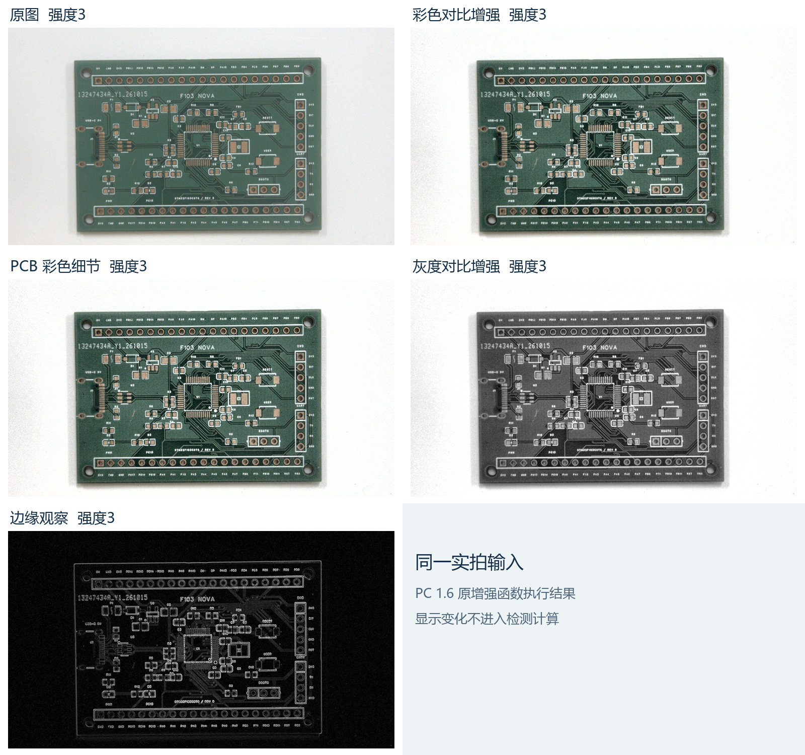

图21  PC1.6同一实拍帧的五种观察模式，强度均为3。由交付增强函数生成，输入保持不变。

彩色对比增强在YCrCb亮度通道进行CLAHE、混合和适度全局拉伸；PCB彩色细节进一步加入有阈值及限幅的高频信息。灰度对比模式只显示增强亮度；边缘观察使用Scharr梯度。强度1～7影响观察效果。 [S14]

“原图对照”用于同屏比较；候选框与覆盖区可分别关闭，便于观察被框线遮挡的浅划痕。保存画面会同时保存原始帧和完整增强图。显示增强不进入检测输入；颜色兼容的结构响应也不会因拖动显示强度而直接改变。

## 27 PC远程升降与PC自动对焦

PC的“升降/对焦”页保留远程控制功能，与FPGA菜单第七项本地自动对焦不同。PC按网络图像计算清晰度并下发PWM目标；本地对焦用FPGA内部每帧指标，不依赖2fps网络帧。两者的搜索步长、ROI和完成逻辑不应混为同一个功能。 [S15]

| 操作区 | 功能 |
| --- | --- |
| 机构行程/PWM | 确认定位型与安全行程；查询状态、配置上下限/初始值/斜坡；显式使能；关闭PWM |
| 手动微调 | 设置目标脉宽，执行目标；设置步长后正负微调；显示目标与已下发PWM |
| PC自动对焦 | 设置搜索区间、粗细步长、机械等待、每点取样数、丢弃新帧数和ROI |
| 过程显示 | 显示采样脉宽和清晰度曲线，记录采样点；支持停止并保持当前PWM |
| 记录 | 成功、取消或失败均写focus_records；记录不包含实际高度反馈 |

PC清晰度采用灰度平滑后的Tenengrad梯度能量，裁去99.5百分位以上的极端响应并按平均亮度平方归一化。每点等待机械稳定，丢弃指定新帧，再对多个新帧指标取中位数。粗扫后在峰值附近细扫，以同向接近降低回差影响，返回最佳点后重新测量。

曲线过平、峰值落边界、回位分数不足原峰值80%或图像不足时不会报告成功。界面启动不自动使能，PC运动前还检查通道是否正在标定或检测。运动后设置模板待确认标志，需重新标定或手动加载当前高度模板。

| PC对焦初始参数 | 值与含义 |
| --- | --- |
| 粗扫 / 细扫 | 250µs / 50µs；与本地100/20/5µs三级搜索不同 |
| 稳定 / 取样 / 丢弃 | 0.5秒；每点取3帧中位数；先丢弃1个新帧 |
| ROI | X=35%、Y=35%、宽30%、高30%；可按板面纹理调整 |
| 首次使能 / 斜坡 | 1500µs；每20ms最多5µs，支持按配置调整 |

> PC历史配置允许500～2500µs，默认搜索也可能采用该范围；FPGA本地菜单为750～2250µs。当前机构应在PC中显式配置为已经确认安全的范围，再使能，不能把界面允许输入当作机械安全证明。

## 28 双向控制协议与通信中断

控制从PC发送到对应FPGA的UDP6002，回复沿该设备接收通道返回。指令包含设备身份、会话令牌、递增序号、行程和脉宽参数及CRC；PC要求匹配本次请求的确认，避免把上一条回复当作成功。 [S07][S09][S15]

| 控制命令 | 作用 |
| --- | --- |
| QUERY | 只读查询，不续期运动租约 |
| CONFIGURE | 建立新会话，校验行程与斜坡，不自动启动PWM |
| ARM | 显式使能并保持当前值 |
| MOVE | 向已配置范围内的目标平滑移动 |
| HOLD | 将目标锁为当前已执行脉宽 |
| DISABLE | 关闭PWM输出 |
| HEARTBEAT | 续期已使能PC会话；本地对焦不会被远程心跳接管 |

远程会话有约2秒租约。通信失联时目标冻结到当前脉宽，保持PWM，不继续朝旧目标移动；恢复后需要明确重新使能。复位或关闭PWM后软件不能保证平台保持力。状态字段描述的是控制器脉宽命令，项目没有编码器或位移传感器确认机械到位。

本地OK执行升降是显式本地接管；本地自动对焦期间锁定控制权，远程配置、移动等动作被拒绝。图像与短状态报文通过发送仲裁器共享以太网，图传等待不应直接停止HDMI。

### 对焦成功后应做什么

先确认清晰度，再锁定镜头、光照和机位，随后在PC建立或确认模板。焦点改变会改变图案宽度、反光和局部细节；直接沿用旧高度模板可能产生误报，也可能降低划痕响应。对焦结果不能代替PCB缺陷检验，更不能代替厚度测量。

## 29 文件记录导出与数据隔离

| 位置 | 内容与用途 |
| --- | --- |
| data/channel_01～03 | 每路独立settings、模板、记录、导出、servo配置和stage_state；互不覆盖 |
| templates / NPZ | 良品模板、几何关系、采样与良品波动组；加载时计算模板SHA256 |
| records/日期_板号 | 原始帧.png、增强候选图.png、检测覆盖区.png和result.json |
| 台账.jsonl / 台账.csv | 时间、会话号、结果、确认数、有效秒数、有效/无效帧、模板和记录目录 |
| exports | 手动保存的原始帧、增强图、显示及检测参数、帧号与来源 |
| focus_records | PC自动对焦参数、采样点、最佳脉宽、取消或失败原因 |
| network | 本程序网络配置及恢复记录；支持恢复本程序所添加配置 |

result.json同时保存软件版本、判定来源、模板路径及哈希、参数快照、确认异常、待复核候选和帧来源。增强候选图用于复看，原始帧用于重算；不能只保留带框截图而丢失原始图像。会话板号是软件生成的ID，并不是自动识别PCB上的生产序列号。 [S08][S10]

便携部署时EXE必须与_internal在一起。升级复制程序文件时保留原data目录，或用--data-dir指向已有数据；全新文件夹首次运行会建立空数据目录，不会自动扫描其它旧版本目录迁移模板。

### 网络设置窗口

先由Windows连接路由器5GHz主Wi-Fi，再扫描并选择正确网卡。程序为接收添加192.168.137.1和三路入站规则，尽量保留现有DHCP、网关及DNS；会检查地址冲突及端口占用。涉及系统网络配置时有Windows管理员提示。“扫描”本身不修改配置，“恢复”仅针对本程序记录的改动。

> 目录中可能仍有历史协议兼容代码或旧界面措辞，不能据此宣称PC1.6实际启用了旧安防、COCO识别或FPGA独立AOI。当前三通道使用固定图传模式。

## 30 实拍实验一 划痕帧A

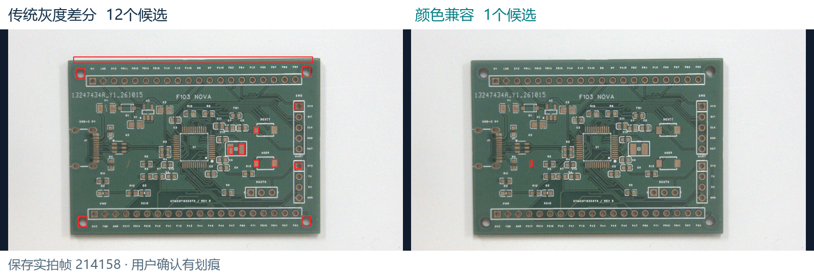

图22  用户确认的划痕实拍帧A。传统灰度差分12个候选，颜色兼容1个细线候选；相同原始帧与几何配准。

记录20261027_214158_fe479be052fc是用户确认有划痕的保存原始帧。旧算法k=10、面积180、峰值31时，焊盘、安装孔和板边产生多处候选。颜色兼容不再把材料颜色本身当缺陷，只保留一处新增细线。 [S16]

| 比较项 | 传统路径 | 颜色兼容路径 |
| --- | --- | --- |
| 单帧候选数 | 12 | 1 |
| 主要问题 | 正常结构和颜色差异多处触发 | 保留用户确认位置的细线 |
| 是否可算检出率 | 不可 | 不可 |
| 样本性质 | 已用于开发与调参的实拍帧 | 同帧方法比较，不是独立盲测 |

图中数量是单帧候选数，不是最终确认缺陷数。新方法能在该样本上把背景候选集中到真实细线，支持继续采用“材质容忍+结构变化”方向，但没有证明换到任意板型都能零误报。

原始帧、历史对照图、当前算法复算参数和来源哈希均随报告保留。报告没有通过人工删除不利框、涂改缺陷位置或重绘PCB来改善结果。

## 31 实拍实验二 划痕帧B

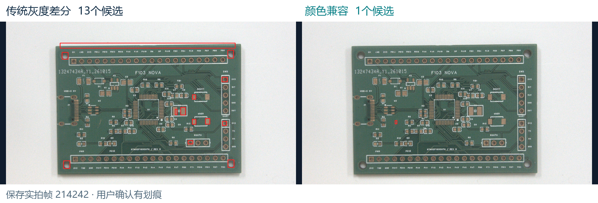

图23  用户圈出真实划痕的帧B。传统13个候选，颜色兼容1个细线候选；两帧划痕可能是同一物理缺陷。

记录20261027_214242_d70ad7341533在旧路径中的全板自动阈值约41.730，而划痕所在区域最大差分约39.935。划痕在连通域面积判断之前就被阈值压掉；仅放宽最小面积并不能恢复它。 [S16]

| 量 | 实测/复算值 | 解释 |
| --- | --- | --- |
| 传统全板阈值 | 41.730 | 被其它正常差异推高 |
| 真实划痕最大差分 | 39.935 | 小于阈值，没有成为传统候选 |
| 传统候选 | 13 | 多数来自其它材质或边缘差异 |
| 颜色兼容候选 | 1 | 细线分支保留弱划痕 |
| 当前PC1.6图示复算 | 面积72、长度24.21、响应7.05 | 使用细线专用规则，不套传统面积门槛 |

前两帧可能为同一划痕的重复拍摄，因此不能把它们算作两个独立缺陷。用户圈线仅用来核对命中位置，没有写入算法条件。当前检测代码不依赖该记录编号或固定的划痕坐标。

该实验解释了为什么“继续提高阈值降低误报”容易漏掉浅划痕。应先解决材料与边缘的正常变化，再给细线保留独立响应与时序确认。

## 32 实拍实验三 正常板

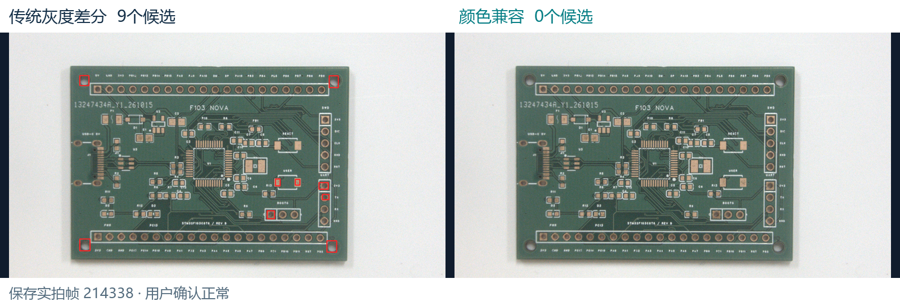

图24  用户确认正常的帧C。传统灰度差分9个候选，颜色兼容0个候选；属于开发样本。

| 保存帧 | 用户真值 | 传统候选 | 兼容候选 |
| --- | --- | --- | --- |
| 214158 | 有划痕 | 12 | 1 |
| 214242 | 有划痕 | 13 | 1 |
| 214338 | 正常板 | 9 | 0 |

三帧对照显示当前固定成像条件下的改善：正常板上大量焊盘与孔边候选被压制，细划痕仍保留。它们参与了方案开发，样本量很小，因此本报告只报告候选变化，不给“100%准确率”或总体误报率。 [S16]

旧手机导出图也做过复测：8张正常、6张划痕、2张表面异物、2张铜片异物。不同拍摄条件仍有误报；历史目录存在重复图和实体板分组不清的问题，不能据此声称按独立PCB完成测试集划分。

> 下一轮验收应按实体板、正反面和缺陷状态隔离开发集与测试集；同一块缺陷板连拍多帧只构成一个缺陷状态，不能充作大量独立样本。

## 33 清晰度与受控色差实验

| 对划痕帧B增加处理 | 传统候选数 | 划痕最大差分 |
| --- | --- | --- |
| 当前处理 | 13 | 39.935 |
| 缩至半尺寸后放大 | 13 | 37.704 |
| 额外高斯σ=1 | 13 | 37.702 |
| 额外高斯σ=2 | 12 | 32.809 |
| 额外高斯σ=3 | 12 | 27.784 |

额外模糊削弱细划痕，却没有稳定减少整板差异。正常帧原为9个候选，σ=2时11个、σ=3时13个。因此旧1024模糊图可能掩盖了一些细节，但继续模糊1080p不是恢复检测效果的可靠方案。本实验没有重建旧硬件Bayer采样链。 [S16]

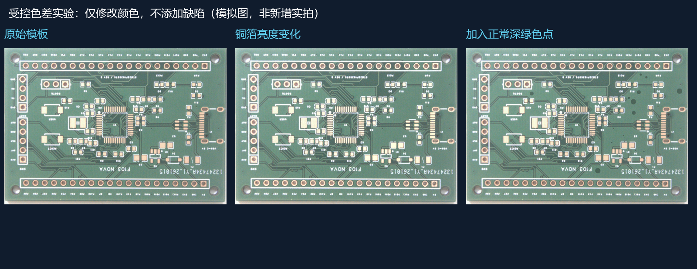

图25  受控颜色变换实验图。底图是实拍，局部黄灰和绿油深浅变化由程序人工施加；不能归为实物缺陷实验。

固定随机种子7913的受控实验中，金属变亮、绿油暗点和组合变色使传统路径分别产生23、8、6个候选，颜色兼容均为0。另有12组人工亮线及6组跨材质块状注入用于开发检查，均命中预期位置；这些是合成可控输入，不证明真实独立缺陷召回率。

工程选择保留原生1080p，针对证据类型改进判定。清晰图既暴露缺陷也暴露正常工艺差异；把正常变化建模或排除，比统一压低画面清晰度更能保留检验信息。

## 34 PC1.6可执行程序的三路回放

图26  最终PC1.6 EXE三路并行接收与排队检测，结果依次NG、OK、NG；本机127.0.0.1回放。

| 验证项 | 记录结果 |
| --- | --- |
| 程序身份 | 1.6.0；最终EXE与构建源码哈希一致 |
| 接收 | 三路1920×1080、约2fps，测试状态64～65个完整帧；各路0损坏包、0丢帧 |
| 结果 | 通道1划痕NG；通道2正常OK；通道3划痕NG |
| 记录隔离 | 各路原始帧与各自输入逐字节一致；结果、模板和参数独立 |
| 单帧处理示例 | 最终状态约517ms、404ms、1492ms；不是稳定吞吐基准 |
| 试验时间设置 | 本机测试入口缩短观察/确认；不把测试秒数当作生产默认20/15秒 |

测试同时验证了旧配置只启用通道1时，新程序仍恢复三路完整功能。预览测试不自动启动检测或使能舵机。以上证明打包程序的收图、调度与记录链可工作，不代表TL-WDR8690在真实三板环境中已经完成相同吞吐验收。 [S17]

本次报告没有向实体开发板发送运动指令或修改网卡设置。三通道记录中的同一划痕输入重复用于功能隔离测试，不能算作三块独立缺陷板。

## 35 历史异物观察与当前适用范围

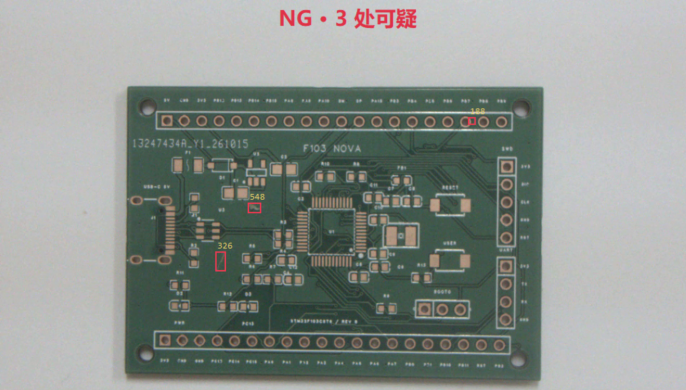

图27a  历史录屏第一块板，用户确认一异物加一划痕。

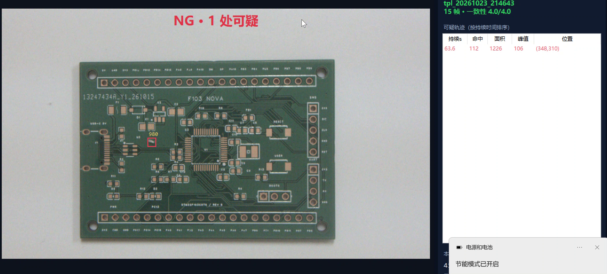

图27b  历史录屏第二块板，用户确认一异物。

这两段录屏来自早期PC检验原型，说明FPGA采图、模板比较与人工造缺陷的验证方式。两段是不同板，不能把第二段未出现第一段划痕解释为漏检。图中旧版框和结果不等同于PC1.6最新算法的独立验收。 [S18]

| 问题类型 | 现有能力 | 尚未证明的范围 |
| --- | --- | --- |
| 可见亮细划痕 | 颜色兼容细线分支，开发实拍复现 | 结构强边缘附近、低对比同色或离焦划痕 |
| 表面异物/铜片 | 材质归属和局部亮结构分支 | 与底材同色且无显著结构、极小粒子 |
| 正常铜色/绿油深浅 | 按允许材质范围降低色差误报 | 所有颜色、所有批次及任意灯光变化 |
| 板边/安装孔 | 保护或屏蔽以压制误报，覆盖区可见 | 板边崩缺、孔壁及孔内质量 |
| 电气/深层缺陷 | 不在本项目任务中 | 短断路电测、内层、层间、焊点内部、厚度和翘曲 |

后续扩展应先定义实际可见且可采样的表面问题，再选择算法。不能仅因为菜单有边缘或二值模式，就把所有线条异常解释为真实导通缺陷。当前系统适合固定工位、同板型同面、可控打光的外观比较与人工复核。

## 36 资源时序与界面空间

| V26.7实现项 | 结果 |
| --- | --- |
| TD工具 | 6.2.190657 |
| 活动RTL | 91份；相对V26.6.1修改6份，其余85份逐字节一致 |
| Slices | 29,952，占87.48% |
| RAM / DSP | 134 / 30（工具计数） |
| Setup WNS / Hold WNS | +0.001ns / +0.020ns |
| 像素 / 串行时钟 | 114.758MHz / 574.053MHz |
| 实现状态 | 布线与定向跨域检查通过；发布记录标为待硬件验证 |

正时序裕量说明该次实现满足已设约束，但裕量很紧，不能据此承诺还能加入大型AI或复杂测量模块。约12.52%的slice余额也不能直接换算为任意新功能余量，RAM、DSP、布线和关键路径都可能先成为限制。原字符ROM及局部路由等告警在发布审计中保留。 [S01][S19]

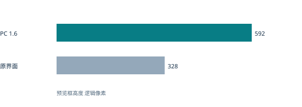

图28  相同1440×852逻辑像素窗口的预览高度变化。单位为Qt逻辑像素，受Windows缩放影响。

PC1.6预览框由1034×328变为1044×592，高度增加约80.5%。右侧参数支持收起，窗口启动时适配可用屏幕。布局测试还覆盖1440×960、1280×800、1040×720和1040×680。原检测、网络和升降等15份Python模块逐字节保持，只有两份UI文件修改。 [S08][S20]

## 37 完整操作流程与故障排查

| 步骤 | 建议操作 |
| --- | --- |
| 1 接线开机 | 相机、HDMI、TF和以太网接好；外部舵机电源共地；三板选择不同启动编号 |
| 2 确认图像 | HDMI为实时画面；PC能连续收到完整1920×1080帧，帧号递增 |
| 3 固定成像 | 调整镜头、机位、曝光和照明；执行本地或PC对焦；完成后保持不动 |
| 4 建立模板 | 放确认良品，分正反面标定；需要时加入不同良品组，保存名称与版本 |
| 5 调检测参数 | 先启用颜色兼容；检查覆盖区；细线、材质与结构分支分别调整 |
| 6 开始一板 | 换入待测板，点击开始检测；等待最终OK/NG/待复核/无效 |
| 7 留档复核 | 查看红色确认框与橙色候选；保存原始帧、参数和台账；下一板重新开始 |
| 8 可选TF留图 | 在FPGA拍照/回放；结束后返回实时并检查图流，再恢复PC检验 |

| 现象 | 优先检查 |
| --- | --- |
| PC收不到图 | 设备编号、网卡地址、主Wi-Fi、隔离网络、防火墙及16001～16003占用 |
| 配准失败/无效 | 是否同板同面、覆盖是否完整、焦点/反光变化、有效纹理和帧新鲜度 |
| 正常板多框 | 颜色兼容是否启用；孔与边缘覆盖；是否重标定；是否混用不同高度模板 |
| 浅划痕漏掉 | 查看原图及细线响应/长度；不要只降块状面积；检查离焦、反光和结构边缘容差 |
| TF照片切换异常 | FILE编号、BMP分辨率/格式、TF状态；旧分辨率照片不保证可回放 |
| 旧错误84 | 来自已删除的FPGA独立AOI定位机制；V26.7不再用它作判定，若仍见应核对烧录文件及旧控制台 |

## 38 验证范围与后续验收

现有证据支持完整工程链路已经具备：原生采集、HDMI观察、TF存储、多身份网络、PC多通道参考比较及升降控制。当前最有价值的检测改进是把正常颜色波动与新增结构分开，并通过有效帧持续性控制最终结果。

| 项目 | 当前证据 | 下一步实体确认 |
| --- | --- | --- |
| V26.7菜单 | RTL逐像素渲染与菜单回归 | 七组菜单逐项操作，Logo、底栏删除和常驻PWM/AF |
| 本地对焦 | 真实RTL控制器配对仿真、故障与双时钟联调 | 同一板重复多次清晰度、耗时和回位稳定性 |
| TF提速 | 引脚级SDHC模型、全尺寸BMP与进度验证 | 实际卡保存和回放各10次，记录平均及最慢值 |
| 三路网络 | 同一bitstream身份测试、PC三路本机回放 | 三台实体板同发，记录每路fps、掉帧与延迟 |
| 颜色兼容检测 | 3帧开发实拍、受控图像实验、EXE回放 | 独立正常板和缺陷状态，固定条件盲测 |
| 光学/计量精度 | 未建立毫米标尺或高度反馈 | 先定义最小可检尺寸及工位标定；本版不做测厚 |

建议验收表按实体板编号、正反面、缺陷类型和位置、图像条件、模板哈希、参数、最终结果及人工复核记录。正常板统计按板次报告误报，缺陷板按真实缺陷位置统计检出；同一缺陷重复拍摄单列重复性。不要混合软件测试、合成图和实拍盲测形成一个总准确率。

版本更新后先做固定测试板回归，再逐步扩展新板型和新照明。对焦速度、TF速度及三路无线吞吐宜分别计时；一项快不代表整机所有业务都快。样机系统可继续发展为可追溯的外观检验工位，但工业通用质量指标需要专门实验支撑。

> 本报告新增的是文档、来源整理和离线图示复算，没有改动两份已交付工程、现场网卡或实体机构。报告生成时未新增上板实验。

## 39 技术来源与版本标识

以下来源均位于本项目工作目录或用户提供的本机资料。Markdown中的条目链接到实际文件；图片来源JSON另记录原始路径、SHA256、裁图范围及证据类型。图示计算记录包含本次PC1.6复算参数。

| 编号 | 来源与用途 |
| --- | --- |
| S01 | V26.7使用说明、验证报告；界面、AF、TF和实现边界 |
| S02 | V26.7 project.json；活动源清单与顶层 |
| S03 | 顶层、session_image_pipeline、bayer_native_rgb565、raster；采集与路径 |
| S04 | smart_app、classic_menu_text、camera_osd；菜单、按键和OSD |
| S05 | video_algorithms、vision_core96、hist_equal4、binary_morph4；八种算法 |
| S06 | fat32_photo、raster_photo_stream、playback_rgb565、sd_spi_block及对应review；文件与SD |
| S07 | focus_metric、focus_controller、servo_control及AF/servo验证；本地运动与对焦 |
| S08 | PC1.6使用说明、验证报告；功能、布局和升级 |
| S09 | scam_boot_profile、camera_ethernet、scam_camera_sender；身份和协议 |
| S10 | multi_aoi_studio、multi_receiver、camera_core、detection_worker；多路软件 |
| S11 | pcb_aoi_core；模板、SIFT、覆盖、传统差分 |
| S12 | surface_features；颜色兼容三分支 |
| S13 | inspection；参数、轨迹、有效帧与终态 |
| S14 | image_enhance；观察增强 |
| S15 | focus_panel、autofocus、focus_protocol；PC运动与对焦 |
| S16 | PC1.3实验报告及real_comparison、blur_results、controlled_production；历史实拍与受控实验 |
| S17 | PC1.6 verification/exe_checks.json；最终EXE三通道回放 |
| S18 | 20261023录屏复核报告及clip1/clip2帧；历史实拍异物 |
| S19 | V26.7 review/final1080/result.json、warning_audit；时序与资源 |
| S20 | PC1.6 preview/geometry.json、ui_source_audit.json；空间与源码审计 |

FPGA bitstream SHA256：62ecfa94e7d30260d49b709e93b4598dfa2dab45f5184a00197aac47f89b09fb。

PC1.6 EXE SHA256：53ea14ee7d41e4954a1ef2c7051f6af51e9bb34e391d9e453f55d221c6af55d2。

## 本机来源链接

- S01 [验证报告.md](<C:/Users/84291/Documents/Codex/2026-10-22/zh/outputs/Smart_Camera_V26_7_FastUI_AFSD_20261102/验证报告.md>)
- S02 [project.json](<C:/Users/84291/Documents/Codex/2026-10-22/zh/outputs/Smart_Camera_V26_7_FastUI_AFSD_20261102/fpga_project/project.json>)
- S03 [smart_camera_ddr_top.v](<C:/Users/84291/Documents/Codex/2026-10-22/zh/outputs/Smart_Camera_V26_7_FastUI_AFSD_20261102/fpga_project/rtl/ddr/smart_camera_ddr_top.v>)
- S04 [smart_app.v](<C:/Users/84291/Documents/Codex/2026-10-22/zh/outputs/Smart_Camera_V26_7_FastUI_AFSD_20261102/fpga_project/v16/rtl/video/smart_app.v>)
- S05 [vision_core96.v](<C:/Users/84291/Documents/Codex/2026-10-22/zh/outputs/Smart_Camera_V26_7_FastUI_AFSD_20261102/fpga_project/v16/rtl/isp/vision_core96.v>)
- S06 [fat32_photo.v](<C:/Users/84291/Documents/Codex/2026-10-22/zh/outputs/Smart_Camera_V26_7_FastUI_AFSD_20261102/fpga_project/v16/rtl/photo/fat32_photo.v>)
- S07 [focus_controller.v](<C:/Users/84291/Documents/Codex/2026-10-22/zh/outputs/Smart_Camera_V26_7_FastUI_AFSD_20261102/fpga_project/rtl/focus/focus_controller.v>)
- S08 [验证报告.md](<C:/Users/84291/Documents/Codex/2026-10-22/zh/outputs/PCB_AOI_Studio_1_6_Compact_20261102/验证报告.md>)
- S09 [camera_ethernet.v](<C:/Users/84291/Documents/Codex/2026-10-22/zh/outputs/Smart_Camera_V26_7_FastUI_AFSD_20261102/fpga_project/rtl/network/camera_ethernet.v>)
- S10 [multi_aoi_studio.py](<C:/Users/84291/Documents/Codex/2026-10-22/zh/outputs/PCB_AOI_Studio_1_6_Compact_20261102/pc_app/source/multi_aoi_studio.py>)
- S11 [pcb_aoi_core.py](<C:/Users/84291/Documents/Codex/2026-10-22/zh/outputs/PCB_AOI_Studio_1_6_Compact_20261102/pc_app/source/pcb_aoi_core.py>)
- S12 [surface_features.py](<C:/Users/84291/Documents/Codex/2026-10-22/zh/outputs/PCB_AOI_Studio_1_6_Compact_20261102/pc_app/source/surface_features.py>)
- S13 [inspection.py](<C:/Users/84291/Documents/Codex/2026-10-22/zh/outputs/PCB_AOI_Studio_1_6_Compact_20261102/pc_app/source/inspection.py>)
- S14 [image_enhance.py](<C:/Users/84291/Documents/Codex/2026-10-22/zh/outputs/PCB_AOI_Studio_1_6_Compact_20261102/pc_app/source/image_enhance.py>)
- S15 [autofocus.py](<C:/Users/84291/Documents/Codex/2026-10-22/zh/outputs/PCB_AOI_Studio_1_6_Compact_20261102/pc_app/source/autofocus.py>)
- S16 [实验报告.md](<C:/Users/84291/Documents/Codex/2026-10-22/zh/outputs/PCB_AOI_Studio_1_3_Surface_20261027/实验报告.md>)
- S17 [exe_checks.json](<C:/Users/84291/Documents/Codex/2026-10-22/zh/outputs/PCB_AOI_Studio_1_6_Compact_20261102/pc_app/verification/exe_checks.json>)
- S18 [复核结论与下一版建议.md](<C:/Users/84291/Documents/Codex/2026-10-22/zh/outputs/PCB_AOI_录屏复核_20261023/复核结论与下一版建议.md>)
- S19 [result.json](<C:/Users/84291/Documents/Codex/2026-10-22/zh/outputs/Smart_Camera_V26_7_FastUI_AFSD_20261102/fpga_project/review/final1080/result.json>)
- S20 [ui_source_audit.json](<C:/Users/84291/Documents/Codex/2026-10-22/zh/outputs/PCB_AOI_Studio_1_6_Compact_20261102/pc_app/verification/ui_source_audit.json>)